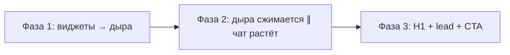
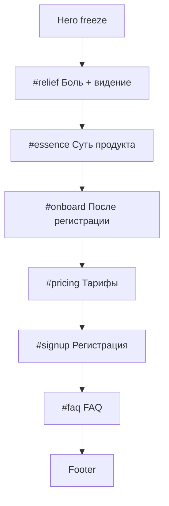

# NeedRa — план лендинга ниже Hero

**Версия:** 0.1  
**Дата:** 14.07.2026  
**Статус:** на утверждении  
**Язык:** русский  
**Hero:** заморожен (не трогаем)  
**Всё ниже hero:** удалить и собрать заново по этому плану

---

## Кратко

Hero «Сингулярность» утверждён и остаётся как есть. Секции `#problem` … `#faq` в `index.html` — **под нож**. Ниже hero строим новую драматургию из 7 блоков по твоему контенту: боль → видение → суть → онбординг → тарифы → регистрация → FAQ. Каждый блок — отдельная интерактивная сцена в тёмной космической эстетике hero, но **без** перегруза GSAP (hero уже «съел» бюджет wow).

---

## 1. Hero — freeze spec (не менять)

### 1.1 Файлы

| Файл | Роль |
|------|------|
| `index.html` | Разметка hero (`#top`, `#heroScene`) |
| `landing-styles.css` | Стили hero, звёзд, дыры, виджетов |
| `landing-main.js` | GSAP ScrollTrigger: 3 фазы схлопывания |
| `landing-hero-stars.js` | Canvas starfield, pause при scroll |
| `landing-hero-blackhole.js` | Чёрная дыра из точек, гало уплотнено |
| `landing-hero-widgets.js` | 42 мини-виджета, scatter «звёздное поле» |
| `backup-v1/` | Бекап до звёзд/дыры (на случай отката) |

### 1.2 Сценарий scroll (канон)



| Фаза | Scroll % | Что происходит |
|------|----------|----------------|
| 1 | 0–48% | 42 виджета стягиваются в чёрную дыру; подсказка «09:34 · отчёты стягиваются в центр» |
| 2 | 48–82% | **Параллельно:** дыра `scale → 0`; из центра растёт поле «Спроси что угодно...» |
| 3 | 78%+ | H1, lead, кнопки; подсказка «09:58 · одна строка» |

### 1.3 Визуал

- Фон: звёздное небо (`#080B0F` canvas)
- Центр: чёрная дыра из **ярких точек** (фотонное кольцо + диск + дуги линзирования)
- Виджеты: scatter по экрану, разный scale/rotate, «дыхание» 11–19s
- Акцент mint `#5DFFC8` / `#6EE7B7` — **только** на финальной строке чата и CTA hero
- Метрики в виджетах: **только «—»**, без выдуманных KPI

### 1.4 Копирайт hero (канон)

- Eyebrow: `Need = запрос · Ra = обмен`
- H1: `Снова открываете пятую вкладку — а ответа всё ещё нет?`
- Lead: `Wildberries отдаёт данные. NeedRa отвечает на ваш вопрос — одной строкой чата. Таблица, график, Excel.`
- Поле чата: `Спроси что угодно...`
- CTA primary: `https://lk.needra.ru/`

### 1.5 Ограничения при freeze

- [ ] Не менять таймлайн 3 фаз без отдельного поручения
- [ ] Не возвращать JPEG/SVG-дыру — только point-renderer
- [ ] Не добавлять фейковые цифры в виджеты
- [ ] `prefers-reduced-motion` fallback обязателен

---

## 2. Что удаляем (под нож)

Из `index.html` убрать целиком:

| Секция | ID | Причина |
|--------|-----|---------|
| Знакомо? | `#problem` | Заменяется блоком «Боль + видение» |
| Ответ за минуту | `#goal` | Влито в подзаголовок |
| Представьте | `#imagine` | Новая сцена «Промпт-билдер» |
| Надежда | `#hope` | Влито в блок «Суть» |
| 4 шага | `#solution` | Новый блок «Как работает» |
| Mock proof | `#proof` | Заменяется live-формой регистрации |
| Дефицит | `#scarcity` | Мягкий scarcity в тарифах |
| CTA-блок | `#cta` | Форма = главный CTA |
| FAQ (старый) | `#faq` | Новый FAQ по твоему списку |

Также обновить:

- `beat-progress` — новые якоря (см. §4)
- `landing-main.js` — убрать scroll-логику старых секций (если есть)
- `landing-styles.css` — вычистить стили удалённых секций после сборки

---

## 3. Новая карта страницы



| # | ID | Название | Источник контента |
|---|-----|----------|-------------------|
| 0 | `#top` | Hero | freeze |
| 1 | `#relief` | Боль → облегчение | Заголовок + подзаголовок |
| 2 | `#essence` | Суть | Один абзац про сервис |
| 3 | `#onboard` | Первый шаг | «Загрузите ключ на чтение…» |
| 4 | `#pricing` | Тарифы | Бесплатно / 5 000 ₽ / по желанию |
| 5 | `#signup` | Регистрация | Форма + подпись под формой |
| 6 | `#faq` | FAQ | 5 вопросов |

**Sticky CTA:** остаётся, но текст сменить на «Зарегистрироваться» с якорем `#signup` (после появления формы в viewport — скрывать или менять на «В личный кабинет»).

---

## 4. Блоки — контент + интерактивный дизайн

### Блок 1 · `#relief` — «Боль → видение»

**Контент (твой):**

- **H2:** Устали путаться в бесконечных сервисах и перегруженных таблицах?
- **Подзаголовок:** Представьте: мгновенные ответы на конкретные вопросы — и своя панель управления магазином, собранная под вас.

**Дизайн-концепт: «Распутывание» (Split Dissolve)**

| Слой | Поведение |
|------|-----------|
| Левая половина (desktop) / верх (mobile) | **Хаос сервисов** — 8–12 «иконок-заглушек» сервисов (без логотипов WB/конкурентов): Excel, «отчёт», «фильтр», «дашборд» — мелкие плитки как в hero, но статичные |
| Правая половина / низ | **Чистая панель** — один mock-блок «ваша панель» с 3 пустыми слотами (таблица · график · маска) |
| Scroll / tap | Граница между хаосом и чистотой **сдвигается** при скролле (GSAP scrub, короткий pin ~120vh) или **свайп-ползунок** на mobile |

**Интерактив:**

- Ползунок «хаос ↔ порядок» — пользователь сам тянет границу (touch-friendly, 44px thumb)
- При 70%+ вправо — подзаголовок подсвечивается mint, хаос-плитки гаснут

**Почему цепляет:** продолжает метафору hero «много → одно», но уже про **смысл**, не про анимацию ради анимации.

**TODO:** [ ] Утвердить: scroll-pin vs только ползунок на mobile

---

### Блок 2 · `#essence` — «Суть продукта»

**Контент:**

> Один сервис — одно поле для промпта. Ваш агент поверх данных WB. Общается на русском. Доступно всё из API Wildberries о вашем бизнесе — и больше. ИИ собирает вид, не подменяет цифры: таблицы, отчёты и графики так, как нужно вам. Сохраните маску для ежедневного обновления. Скачайте нужное в Excel.

**Дизайн-концепт: «Живой абзац» (Keyword Orbit)**

| Элемент | Поведение |
|---------|-----------|
| Текст | Один абзац, крупная типографика (20–22px mobile, 24px desktop), max-width 42em |
| Ключевые слова | 6 якорей выделены: **промпт**, **агент**, **API WB**, **маска**, **Excel**, **русский** |
| Hover / tap | Тап по слову — **мини-карточка** снизу (не модал): иконка + 1 строка пояснения |

**Примеры карточек (без цифр):**

| Слово | Подсказка |
|-------|-----------|
| промпт | Один запрос вместо десятка фильтров |
| агент | Ваш слой поверх уже загруженных данных |
| API WB | Только ваши данные из кабинета |
| маска | Шаблон вида для ежедневного обновления |
| Excel | Выгрузка результата в один клик |
| русский | Вопросы и ответы без «английского BI» |

**Интерактив:**

- При первом тапе — лёгкая **пульсация** кольца ↻ (из philosophy) вокруг слова
- Опционально: ScrollTrigger **подсвечивает** слова по очереди при проходе секции (без pin)

**Почему цепляет:** длинный абзац не «простыня» — становится **картой возможностей**.

**TODO:** [ ] Утвердить список 6 якорных слов

---

### Блок 3 · `#onboard` — «После регистрации»

**Контент:**

> Загрузите ключ на чтение тех разделов WB, которые хотите анализировать.

**Дизайн-концепт: «Ключ → поток» (3-step reveal)**

| Шаг | Визуал | Текст |
|-----|--------|-------|
| 1 | Иконка ключа (outline) | Регистрация |
| 2 | Стрелка ↻ | Ключ API (чтение) |
| 3 | Поток точек → чат | Агент готов к вопросам |

**Интерактив:**

- **Горизонтальный stepper** — тап по шагу раскрывает панель (accordion на mobile)
- Шаг 2 активен по умолчанию — показывает **чеклист разделов WB** (без названий чужих UI): «заказы», «остатки», «реклама», «финансы» — как toggle chips (визуально, не форма)
- Анимация: при выборе ≥1 chip — точки «текут» по кольцу к центральной строке (CSS, не canvas)

**Почему цепляет:** снимает страх «а что именно подключать» — без обещания лишнего доступа.

**TODO:** [ ] Утвердить список разделов WB для chips (только подтверждённые)

---

### Блок 4 · `#pricing` — «Тарифы»

**Контент (подтверждённый):**

| Уровень | Описание |
|---------|----------|
| **Бесплатно** | первая загрузка всех данных из API + общение с агентом |
| **5 000 ₽/мес** | ежедневное наполнение данными |
| **По желанию** | себестоимость, система налогообложения и другие индивидуальные метрики — для более точных расчётов |

**Дизайн-концепт: «Орбита ценности» (Pricing Cards + Orbit)**

| Карточка | Позиция | Акцент |
|----------|---------|--------|
| Бесплатно | Центр, крупнее | Mint border, badge «Старт» |
| 5 000 ₽/мес | Справа, слегка приподнята | Белый текст, mono для цены |
| По желанию | Слева, приглушённая | Пунктирная рамка, «дополнительно» |

**Интерактив:**

- **Toggle «Сейчас / Каждый день»** — переключает подсветку между «Бесплатно» и «5 000 ₽» (не скрывает карточки — меняет glow)
- Hover/tap на «По желанию» — раскрывает 3 bullet без цен: себестоимость · налогообложение · индивидуальные метрики
- Без fake urgency: нет таймеров, нет «осталось 3 места»

**Почему цепляет:** цена **5 000 ₽** — единственная цифра на лендинге (подтверждена); визуально ясно «бесплатный вход → платное обновление».

**TODO:** [ ] Утвердить: показывать ли «5 000 ₽» крупно на mobile sticky-bar при скролле к pricing

---

### Блок 5 · `#signup` — «Регистрация» (главный CTA)

**Контент:**

- **H2:** Первая загрузка данных — бесплатно
- **Поля:** Email* · Телефон · Ключ API WB (чтение)* · Согласие на обработку ПДн*
- **Кнопка:** Зарегистрироваться и загрузить данные →
- **Под формой:** Ежедневное обновление — 5 000 ₽/мес · свой агент · один сервис вместо пятидесяти
- **Fallback:** Уже есть аккаунт → https://lk.needra.ru/

**Дизайн-концепт: «Гравитационная форма» (Signup Singularity)**

| Элемент | Поведение |
|---------|-----------|
| Фон секции | Звёзды **тише**, чем в hero (меньше плотность) — ощущение «приземления» |
| Форма | Стеклянная панель (`backdrop-filter` только здесь), mint focus ring |
| Прогресс | 4 поля = 4 точки-звезды над формой; заполненное поле → точка загорается |
| Submit | Кнопка с лёгким «всасыванием» particles к центру при hover (CSS only) |

**Интерактив:**

- Валидация inline (email format, required) — без отправки на лендинге (action → `lk.needra.ru` или заглушка `TODO: endpoint`)
- Поле «Ключ API» — toggle «показать/скрыть» + ссылка «Где взять ключ в WB» (URL **TODO** — не выдумывать)
- Чекбокс согласия — без предзаполнения; ссылка на политику (**TODO:** URL)

**Почему цепляет:** форма — **кульминация** лендинга, не приложение внизу; визуально связана с hero-строкой «Спроси что угодно...».

**TODO:** [ ] Endpoint формы регистрации  
**TODO:** [ ] URL политики конфиденциальности  
**TODO:** [ ] URL инструкции «ключ API WB»

---

### Блок 6 · `#faq` — «Частые вопросы»

**Контент (твой):**

| Вопрос | Ответ |
|--------|-------|
| Откуда данные? | API Wildberries, ваши собственные данные. Хранение в NeedRa. |
| Обновление каждый день? | Первая загрузка бесплатна. Автообновление — 5 000 ₽/мес. |
| Свой агент? | Да, поверх ваших данных WB. |
| Заменяет ЛК WB? | Нет. Слой аналитики через диалог. |
| Есть ли запись? | Пока нет. Будем аккуратно внедрять по мере развития проекта. |

**Дизайн-концепт: «Терминал ответов» (Accordion Command Line)**

| Элемент | Поведение |
|---------|-----------|
| Вопрос | Строка как CLI: `> Откуда данные?` |
| Ответ | Раскрывается с `opacity + height`, mono-метка `↳` слева |
| Активный | Одна открытая позиция (остальные закрываются) |

**Интерактив:**

- Клавиатура: Enter/Space на summary
- Опционально: **поиск по FAQ** — одно поле фильтрует вопросы (без AI)

**Почему цепляет:** tech-тон без сухости; закрывает возражения перед/после формы.

---

## 5. Визуальная система (ниже hero)

Наследуем от hero, но **тише**:

```css
/* Ниже hero — не конкурировать с сингулярностью */
--section-canvas: #0A0E14;
--section-surface: #121820;
--section-text: #E8EDF2;
--section-muted: #8B95A3;
--section-accent: #5DFFC8;  /* mint — CTA, focus, 1 glow на секцию */
--section-warm: #FF6B4A;    /* только pain-chips, не CTA */
```

| Правило | Hero | Ниже hero |
|---------|------|-----------|
| Canvas-анимации | starfield + point blackhole | Только CSS / лёгкий GSAP |
| Mint accent | финал схлопывания | форма, pricing toggle, keyword tap |
| Виджеты-дашборды | 42 штуки | макс. 12 в блоке relief, статичные |
| Pin scroll | ~300vh | макс. 120vh на блок relief |
| Шрифт | Sora (уже подключён) | Sora display + system body |

---

## 6. Навигация и прогресс

**Новый `beat-progress` (7 точек):**

| Точка | Якорь | Метка |
|-------|-------|-------|
| 1 | `#top` | Hero |
| 2 | `#relief` | Боль |
| 3 | `#essence` | Суть |
| 4 | `#onboard` | Старт |
| 5 | `#pricing` | Тарифы |
| 6 | `#signup` | Регистрация |
| 7 | `#faq` | FAQ |

Убрать ссылки на удалённые `#problem`, `#goal`, …

---

## 7. Технический план реализации

### Фаза A — зачистка
1. Вырезать секции `#problem`…`#faq` из `index.html`
2. Обновить `beat-progress`
3. Удалить мёртвые стили в `landing-styles.css`

### Фаза B — каркас
4. Добавить 6 секций с контентом (статичная вёрстка, mobile-first)
5. Подключить `landing-below.js` (новый файл — интерактив ниже hero)

### Фаза C — интерактив
6. `#relief` — ползунок + опциональный scrub
7. `#essence` — keyword cards
8. `#onboard` — stepper + chips
9. `#pricing` — toggle + card glow
10. `#signup` — form progress + validation stub
11. `#faq` — accordion + filter

### Фаза D — polish
12. ScrollTrigger refresh для новых pin-секций
13. `prefers-reduced-motion` для всех новых анимаций
14. Self-check: нет фейковых метрик, цена только 5 000 ₽, CTA `lk.needra.ru`

---

## 8. Ограничения (обязательно)

- [x] Hero не трогаем
- [ ] Не выдумывать метрики клиентов, отзывы, скидки
- [ ] **5 000 ₽/мес** — единственная платная цифра (подтверждена тобой)
- [ ] «пятидесяти» в подписи формы — маркетинговая метафора, не статистика (ок)
- [ ] Не клонировать UI Wildberries
- [ ] Форма: не собирать ПДн без реального endpoint (пока stub / redirect)
- [ ] Запись разговоров — честно «пока нет»

---

## 9. Открытые вопросы

| # | Вопрос | Блокирует |
|---|--------|-----------|
| 1 | Endpoint регистрации (POST URL) | submit формы |
| 2 | URL политики конфиденциальности | чекбокс согласия |
| 3 | URL «как получить ключ API WB» | поле ключа |
| 4 | Список разделов WB для chips в onboard | копирайт chips |
| 5 | Relief: scroll-pin или только ползунок на mobile? | GSAP сложность |
| 6 | Sticky CTA: «Зарегистрироваться» или «В ЛК»? | header/footer |

---

## 10. Рекомендация по порядку пиления

1. **Зачистка** + статичный каркас всех 6 блоков (можно сразу увидеть текст)
2. **`#signup`** — главная конверсия
3. **`#pricing`** — снимает вопрос «сколько стоит»
4. **`#relief`** — эмоциональный мост от hero
5. **`#essence`** + **`#onboard`** + **`#faq`** — интерактив по очереди

---

## Next step

1. **Прочитай этот файл** — поправь копирайт, порядок блоков, интерактивы.
2. **Ответь в форме ниже** (или напиши в чат): что утверждаем, что режем, с чего начинаем.
3. После «утверждено» → переключайся в **Design mode** и пиши **«пилим ниже hero по плану»** — начну с зачистки и каркаса `#signup` + `#pricing`.

---

*Файл: `landing-below-hero-plan.md` · Hero freeze: `backup-v1/` + текущие `landing-hero-*.js`*
